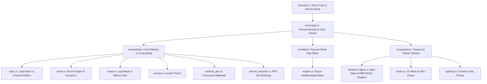
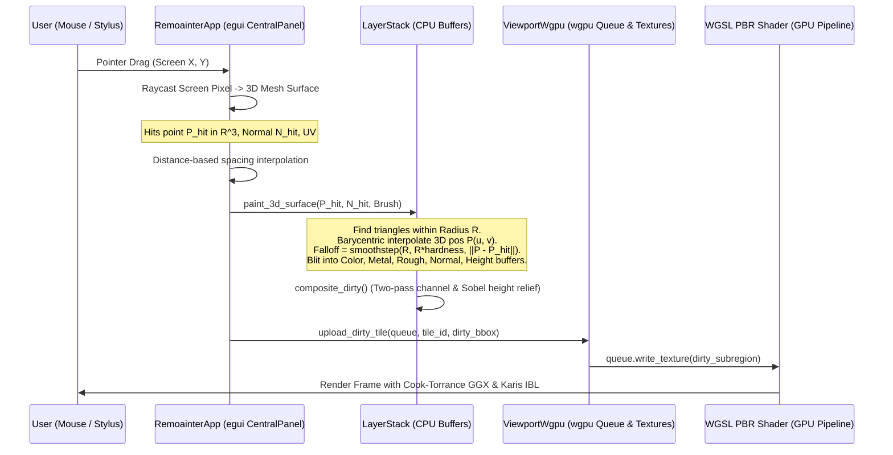
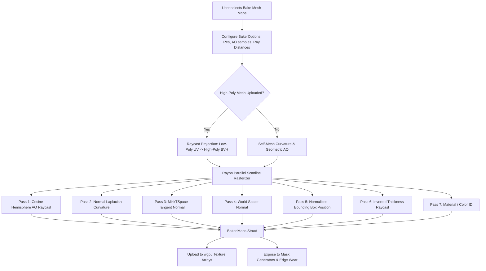
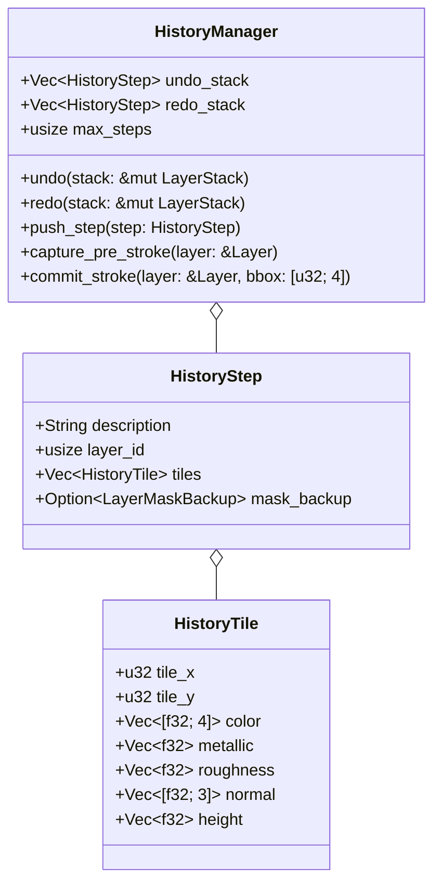

# REMoAINTER v0.2 — Architecture Specification

This document details the internal architecture, memory models, data structures, and execution pipelines of **REMoAINTER v0.2**.

---

## 1. System Module Map



### Module Responsibilities

| Subsystem | Primary Source Files | Responsibility |
| :--- | :--- | :--- |
| **App Core & UI** | `src/main.rs`<br>`src/ui/app.rs`<br>`src/ui/icons.rs`<br>`src/ui/theme.rs` | Window lifecycle, event dispatching, egui dock panels, modal dialogs, status bar, and shortcut translation. |
| **Painting Engine** | `src/painting/layer.rs`<br>`src/painting/brush.rs`<br>`src/painting/mask.rs`<br>`src/painting/anchor.rs`<br>`src/painting/material_gen.rs` | Channel pixel buffers, 3D Euclidean surface projection painting, layer compositing, mask effect evaluation, procedural materials. |
| **Baking Engine** | `src/baker/engine.rs`<br>`src/baker/mod.rs` | High-to-low poly raycasting, cage bounds, MikkTSpace tangent vectors, Ambient Occlusion, Curvature, Position, Thickness, and ID map generation. |
| **Graphics & Viewport** | `src/graphics/viewport_wgpu.rs`<br>`src/graphics/mesh.rs`<br>`src/graphics/lighting.rs` | Native Vulkan hardware acceleration via `wgpu`, Cook-Torrance GGX WGSL shaders, ACES tonemapping, wireframe overlay, HDR environment sampling, and mesh I/O. |

---

## 2. Storage Models

### A. Layers & Channel Buffers
A project's texturing state is managed by `LayerStack`, which holds a linear list of `Layer` structs evaluated from bottom (index 0) to top:

```rust
pub struct LayerStack {
    pub layers: Vec<Layer>,
    pub active_layer_index: usize,
    pub width: u32,
    pub height: u32,

    // Flattened composite buffers (Width * Height)
    pub composite_color: Vec<[f32; 4]>,
    pub composite_metallic: Vec<f32>,
    pub composite_roughness: Vec<f32>,
    pub composite_normal: Vec<[f32; 3]>,
    pub composite_lit: Vec<[f32; 4]>,
}
```

Each `Layer` contains discrete channel buffers stored in flat CPU heap arrays:
```rust
pub struct Layer {
    pub id: usize,
    pub name: String,
    pub layer_type: LayerType, // Paint, Fill, Folder
    pub visible: bool,
    pub opacity: f32,
    pub blend_mode: BlendMode, // Normal, Multiply, Screen, Overlay, PassThrough
    pub folder_expanded: bool,

    // Mask & Anchor
    pub mask: Option<LayerMask>,
    pub anchor_point: Option<AnchorPoint>,
    pub color_tag: Option<u8>,

    // Fill parameters (for Fill layers)
    pub fill_color: [f32; 4],
    pub fill_metallic: f32,
    pub fill_roughness: f32,
    pub fill_height: f32,

    // Channel Pixel Buffers (sized width * height)
    pub color_buffer: Vec<[f32; 4]>,
    pub metallic_buffer: Vec<f32>,
    pub roughness_buffer: Vec<f32>,
    pub normal_buffer: Vec<[f32; 3]>,
    pub height_buffer: Vec<f32>,

    pub width: u32,
    pub height: u32,
}
```

### B. Masks & Effect Stack
Masks are scalar maps ($[0.0, 1.0]$) that multiply or blend layer contribution:
```rust
pub struct LayerMask {
    pub mask_type: MaskType, // White (1.0), Black (0.0)
    pub buffer: Vec<f32>,    // Flattened grayscale bitmap
    pub effects: Vec<MaskEffect>,
    pub width: u32,
    pub height: u32,
}

pub enum MaskEffect {
    Fill { value: f32, noise_frequency: f32, blend_mode: MaskBlendMode, opacity: f32 },
    Paint { blend_mode: MaskBlendMode, opacity: f32 },
    Generator {
        name: String,
        wear_level: f32,
        contrast: f32,
        dirt_amount: f32,
        invert: bool,
        use_ao: bool,
        use_curvature: bool,
        anchor_name: Option<String>,
        blend_mode: MaskBlendMode,
        opacity: f32,
    },
    Levels { black_in: f32, white_in: f32, gamma: f32 },
    Invert,
}
```
During `recompute()`, each effect is evaluated sequentially and blended into `mask.buffer`.

### C. Texture Sets & UDIM Tiles
- Currently, the active mesh is stored in `RemoainterApp::mesh` with channels defined in `texture_channels: Vec<TextureChannel>`.
- **Target reference PBR suite Architecture**:
  - `TextureSet` represents an individual material index or UV tile.
  - Multi-set meshes maintain an array of `TextureSet` instances, each owning an isolated `LayerStack`, `BakedMaps`, and GPU texture handles.
  - UDIM tiles correspond to UV coordinates $[u, v]$ mapped to tile IDs $1000 + \lfloor u \rfloor + 1 + 10 \times \lfloor v \rfloor$.

---

## 3. Paint Stroke Pipeline (Pointer to GPU)



### Detailed Execution Steps:
1. **Raycast Hit Detection**:
   When painting in the 3D viewport, camera ray $\vec{R}(t) = \vec{O} + t \vec{D}$ is intersected against all triangles of `Mesh`. The nearest valid intersection yields hit position $P_{\text{hit}}$, surface normal $N_{\text{hit}}$, and barycentric UV.
2. **Spacing & Stroke Smoothing**:
   If distance from previous stamp $\ge \text{brush.size} \times \text{brush.spacing}$, intermediate stamps are generated via linear interpolation. LazyMouse stabilizer filters high-frequency jitter.
3. **3D Euclidean Surface Projection**:
   Instead of naively stamping in 2D UV space (which tears across seams and pinches at poles), `LayerStack::paint_3d_surface` marches over all triangles whose 3D bounding sphere overlaps $(P_{\text{hit}}, R_{\text{brush}})$. For every texel in those triangles, its real 3D coordinate $P(u, v)$ is calculated. Texels within $R_{\text{brush}}$ receive paint proportional to distance and surface normal angle falloff. Signed determinant checks ensure mirrored UV islands receive paint with correct winding.
4. **Channel Blitting**:
   The active `Layer`'s pixel buffers (`color_buffer`, `roughness_buffer`, etc.) are updated based on active brush channel switches (`paint_color`, `paint_roughness`, etc.).
5. **Compositing**:
   `composite_dirty()` evaluates channel modifications within the dirty region, dynamically calculates 3×3 Sobel tangent-space relief from height displacements, and blends onto base normals using Reoriented Normal Mapping (RNM).
6. **GPU Texture Upload**:
   `upload_dirty_tile()` invokes `queue.write_texture()` on the allocated `wgpu::Texture` 2D array layers, uploading only the modified bounding box sub-rectangle.
7. **Viewport Draw**:
   `ViewportWgpu` binds the texture array bind group and executes Cook-Torrance GGX and Karis split-sum IBL shading in WGSL.

---

## 4. Mesh Map Baking Pipeline



### Baking Engine Internals:
- **Parallel Rasterization**: Uses `rayon` to divide the UV height into parallel chunks.
- **GPU Compute Baker**: Native `wgpu` compute shader pipeline (`GpuBakerCompute`) executing WGSL compute kernels (`@compute @workgroup_size(8, 8, 1)`) for high-throughput map generation.
- **MikkTSpace Parity**: Tangents and bitangents computed per vertex. High-poly normals are rotated into the low-poly tangent frame and packed into $16$-bit normal buffers.
- **AO Solver**: Generates stratified cosine-weighted hemisphere rays, tests ray intersections against geometry BVH, and integrates unoccluded radiance.
- **Curvature Solver**: Evaluates divergence of the normal field across adjacent texels to isolate sharp convex ridges ($> 0.5$) from concave crevices ($< 0.5$).
- **UDIM Batch Baking**: `BakerEngine::bake_all_udim` culls triangles per UV tile offset ($1001 + u + 10v$) and bakes multi-tile sets concurrently.
- **DirectX / OpenGL Normal Orientation**: Inverts the Green channel if `invert_normal_y` is checked.

---

## 5. History & Undo/Redo System (`painting::history`)

### Implemented Architecture
To deliver non-destructive undo/redo without excessive RAM consumption, REMoAINTER implements a tile-based sparse delta history manager:



#### Key Architecture Principles:
1. **Tile-Based Sparse Channel Storage**:
   - 2K/4K channels are partitioned into $64 \times 64$ texel tiles (`TILE_SIZE = 64`).
   - Brush strokes capture only the pre-stroke state of modified tiles intersecting the stroke bounding box into `HistoryTile`.
   - Reverting a stroke copies back only the touched tiles across all 5 channels (`Color`, `Metallic`, `Roughness`, `Normal`, `Height`), reducing stroke history memory from $\sim 64\text{MB}$ to $< 500\text{KB}$.
2. **Transaction Lifecycle**:
   - Pointer down captures pre-stroke tile state for the layer and mask.
   - Pointer move accumulates the dirty bounding box.
   - Pointer up finalizes and commits the `HistoryStep` to `undo_stack` and clears `redo_stack`.
3. **Interactive History Panel**:
   - The UI displays an interactive timeline list of past actions with click-to-revert state restoration.

---

## 6. Shaders & Viewport Rendering Core (`graphics/viewport_wgpu.rs`)

### A. Native wgpu / Vulkan Hardware Shading Architecture
The viewport utilizes custom WGSL shader pipelines executed via `wgpu 22.1` targeting Vulkan on Linux/Windows, Metal on macOS, and DX12 on Windows:

1. **`PbrShader` (WGSL)**:
   - **Vertex Shader**: Transforms vertex coordinates to world and clip space using Vulkan depth conventions ($[0.0, 1.0]$); constructs normalized tangent-bitangent-normal matrix $v_{\text{tbn}} = [T, B, N]$ using vertex tangents and bitangent signs ($A_{\text{tangent}}.w$).
   - **Fragment Shader**:
     - Evaluates Cook-Torrance microfacet specular BRDF:
       - NDF: $D_{\text{GGX}}(N \cdot H, \alpha)$ (Trowbridge-Reitz)
       - Geometry: $G_{\text{Smith-Schlick}}(N \cdot V, N \cdot L, \alpha)$ height-correlated
       - Fresnel: $F_{\text{Schlick}}(V \cdot H, F_0)$ modified by roughness for grazing angles
     - Split-Sum IBL:
       - Radiance: Sampled from equirectangular/cubemap HDR environment map (`t_env_map`) with explicit roughness mip-level sampling.
       - Environment BRDF: Looked up from precomputed $512 \times 512$ 2D BRDF LUT texture (`t_brdf_lut`).
     - Dynamic UDIM Multi-Tile Lookup (`resolve_udim_coords`):
       - Samples 2D texture arrays (`texture_2d_array<f32>`) supporting up to 16 concurrent tiles.
     - Tone Mapping & Post-Processing:
       - SSAO contact shadowing and Bloom highlights extraction
       - Standard ACES Filmic curve mapping high-dynamic-range radiance into linear range, followed by sRGB gamma encoding ($x^{1/2.2}$).
2. **`SkyboxShader` (WGSL)**:
   - Panoramic equirectangular skybox environment sphere with adjustable rotational yaw, exposure, and blur factor.
3. **`WireframeShader` (WGSL)**:
   - Renders polygon line index pairs over geometry using dedicated line topology and cyan color token (`#26bfe6`).
4. **`GridPipeline` (WGSL)**:
   - Renders dark slate ground plane grid lines and RGB XYZ world coordinate axes.

### B. Viewport Bind Group Allocations

| Group | Binding | Resource Type | Target / Description |
| :---: | :---: | :--- | :--- |
| `@group(0)` | `@binding(0)` | Uniform Buffer | `PbrUniforms` (416 bytes std140 layout: camera, model, lighting, post-processing) |
| `@group(1)` | `@binding(0)` | Sampler | `s_repeat`: Linear filtering with repeat wrapping |
| `@group(1)` | `@binding(1)` | Sampler | `s_clamp`: Linear filtering with clamp-to-edge |
| `@group(1)` | `@binding(2)` | `texture_2d_array<f32>` | BaseColor 2D array texture |
| `@group(1)` | `@binding(3)` | `texture_2d_array<f32>` | Metallic 2D array texture |
| `@group(1)` | `@binding(4)` | `texture_2d_array<f32>` | Roughness 2D array texture |
| `@group(1)` | `@binding(5)` | `texture_2d_array<f32>` | Tangent-space Normal 2D array texture |
| `@group(1)` | `@binding(6)` | `texture_2d_array<f32>` | Baked Ambient Occlusion 2D array texture |
| `@group(1)` | `@binding(7)` | `texture_2d_array<f32>` | Baked Curvature 2D array texture |
| `@group(1)` | `@binding(8)` | `texture_2d<f32>` | HDR Environment Map (`Rgba16Float`) |
| `@group(1)` | `@binding(9)` | `texture_2d<f32>` | Pre-integrated 2D split-sum BRDF LUT (`Rg16Float`) |
